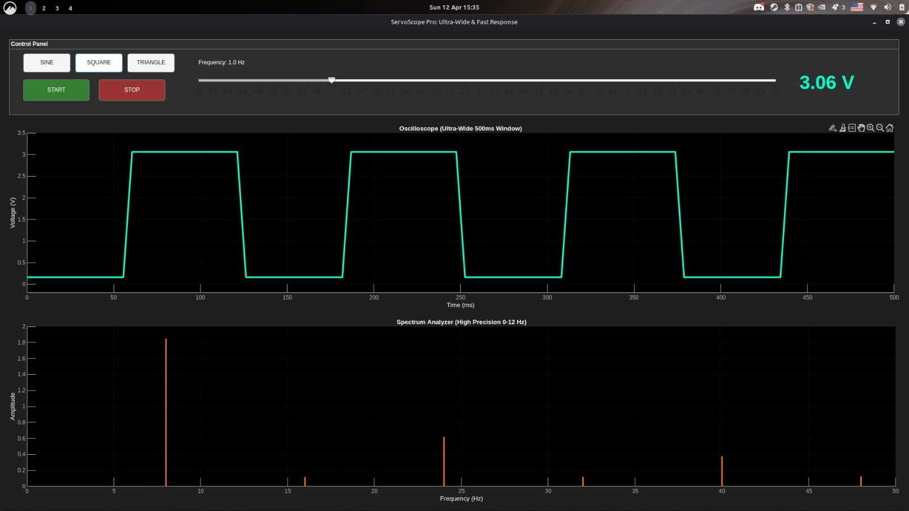
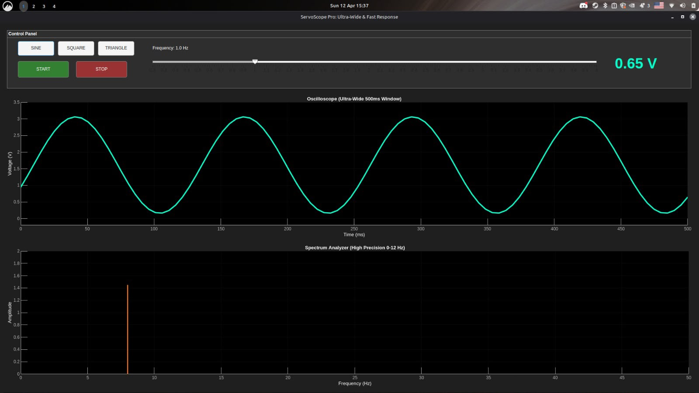
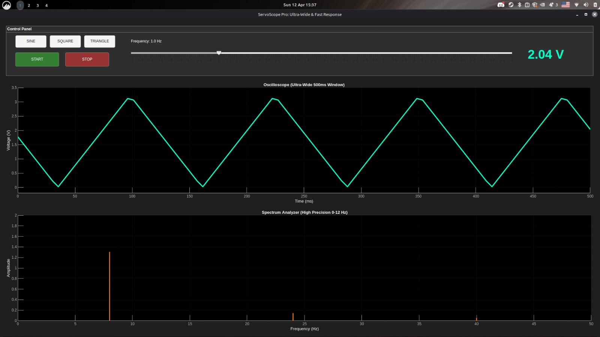

# ESP32-MATLAB Hardware-in-the-Loop (HIL) Signal Analyzer

A real-time Hardware-in-the-Loop (HIL) system that integrates an ESP32 microcontroller with MATLAB. This project performs digital waveform generation, Fast Fourier Transform (FFT) analysis, and synchronized physical actuation using a servomotor.

## 📌 Key Features
* **Real-time Signal Processing:** Digital waveform generation and FFT analysis executed in MATLAB.
* **Hardware-in-the-Loop:** Seamless synchronization between MATLAB mathematical models and ESP32 physical outputs.
* **Safety Constraints:** Mathematical signals mapped to PWM outputs are strictly constrained within a safe **0.16V – 3.06V** operational limit to protect the physical actuator.
* **Robust Communication:** Bidirectional serial communication established at **115200 baud** rate, maintaining a stable **200 Hz** sampling frequency for accurate and continuous data streaming.

## 🛠️ Hardware Requirements
* ESP32 Development Board
* Servomotor 
* Jumper wires & Breadboard
* USB Cable for serial communication and power

## 💻 Software Requirements
* **MATLAB** (with basic signal processing capabilities)
* **Arduino IDE** or **PlatformIO** for flashing the ESP32
* ESP32 Board Package installed in your IDE

## 📊 Results & Demonstration

The custom "ServoScope Pro" interface allows real-time control and visualization of different waveforms, displaying both the time-domain signal and its frequency spectrum (FFT).

### Square Wave Analysis


### Sine Wave Analysis


### Triangle Wave Analysis



## 📂 Project Structure
```text
📦 ESP32-MATLAB-Hardware-in-the-Loop-Signal-Analyzer
 ┣ 📂 ESP32_Firmware      # C++ code for the ESP32 microcontroller
 ┣ 📂 MATLAB_Scripts      # MATLAB scripts for signal generation and FFT
 ┣ 📂 Hardware_Schematics # Wiring diagrams and circuit schematics
 ┗ 📜 README.md
